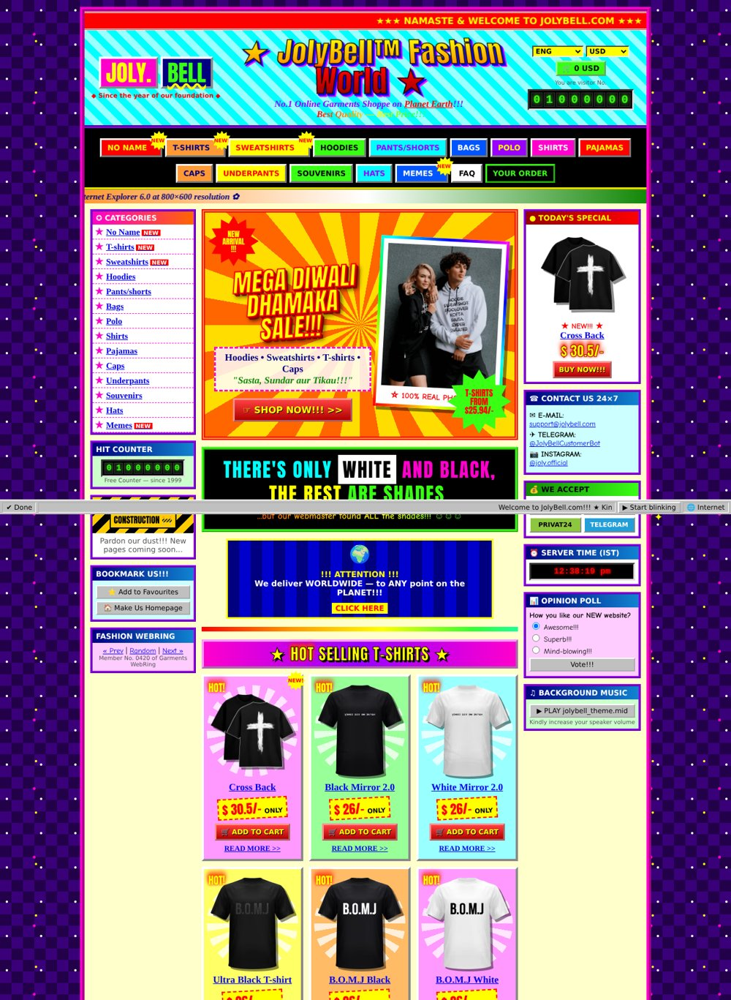

# JolyBell — редизайн в стиле 2000-х

Неофициальный пародийный редизайн [jolybell.com](https://jolybell.com/en): Geocities-эстетика начала 2000-х плюс «индийский» e-commerce с кричащими цветами, бегущими строками и мигающими значками.

## Как открыть

Откройте `index.html` в браузере. Сборка и сервер не нужны: всё лежит в одном файле. Из сети подгружаются шрифты Google Fonts и фото товаров. Без сети страница тоже работает, только вместо фото будут нарисованные картинки.

## Что внутри

- Данные с настоящего сайта: меню из 14 категорий, слоган «There's only white and black, the rest are shades», все 16 футболок каталога с реальными фото и ценами, баннер с худи, e-mail, Telegram, Instagram и способы оплаты. Карточки ведут на страницы товаров jolybell.com.
- Фото не лежат в репозитории, а грузятся с CDN jolybell (`cdn.jolybell.com`). Если CDN их не отдаст, на их месте автоматически появятся нарисованные SVG-футболки и SVG-худи.
- Приметы 2000-х: `<marquee>`, мигающий текст, WordArt-заголовки, крутящиеся звёзды, счётчик посетителей, баннер «Under construction», гостевая книга, вебринг, кнопки 88×31, «Best viewed in IE 6.0», бегущий заголовок вкладки, искры за курсором, поддельная статус-строка IE и всплывающее окно Windows 98 «Вы миллионный посетитель!».
- «Индийский» стиль: шафраново-зелёные градиенты, лучи-санбёрст, «MEGA DIWALI DHAMAKA SALE!!!», цены вида «$ 26/- ONLY», «Kindly do the needful», «Sasta, Sundar aur Tikau».
- Работает корзина (сумма в шапке), опрос, гостевая книга (ничего никуда не отправляет) и фоновая «MIDI»-музыка: оригинальная мелодия на WebAudio, включается только по кнопке.

## Доступность

Мигание не чаще ~1–2 раз в секунду и только на мелких элементах. Кнопка **⏸ Stop blinking** в статус-строке выключает все анимации и бегущие строки. При системной настройке «уменьшить движение» (`prefers-reduced-motion`) анимации отключаются сами.
